<!-- Generated by scripts/render_readme_cards.py. Edit config.json or readme_extra.md, not this file. -->

<a href="https://portfolio-sahilmaddis-projects.vercel.app">Portfolio</a> · <a href="https://www.linkedin.com/in/sahil-maddi/">LinkedIn</a> · <a href="https://portfolio-sahilmaddis-projects.vercel.app/Maddi_Sahil_Java_Developer_Role_Resume.pdf">Resume</a>

<b>About me</b>

- 💼 **Software Engineer at HCLTech**, building backend services and APIs for enterprise clients
- 🔁 Previously at **Sage IT**, where I built a version migration tool for TIBCO API Management and **SHIP AI**, which migrates integration projects between TIBCO BW6, MuleSoft and WSO2 using the OpenAI API
- 🎓 **ServiceNow Certified** System Administrator (CSA) and Application Developer (CAD)
- 🔍 Open to **Java Full Stack** and **Backend Developer** roles

<b>Full tech stack</b>

**Languages** · Java · SQL · JavaScript · TypeScript 
**Backend** · Spring Boot · Spring Security · Hibernate · Microservices · REST APIs 
**Frontend** · React · Angular · Tailwind CSS · Bootstrap 
**Data & messaging** · MySQL · PostgreSQL · Oracle SQL · Redis · Apache Kafka 
**DevOps & tools** · Docker · Jenkins · Git · Maven · Gradle · Postman · AWS DevOps · ServiceNow

<b>Certifications</b>

- [ServiceNow Certified System Administrator (CSA)](https://www.credly.com/badges/36d53276-f938-47e3-a2bf-fbd9bf21e47c)
- [ServiceNow Certified Application Developer (CAD)](https://www.credly.com/badges/72f0e23e-e383-48f8-bebc-e4eb9daa87d2)
- Google Cloud: [Deploy an Agent with ADK](https://www.credly.com/badges/c477205a-060a-4fd4-8128-a5dfc1fa597d) · [Evaluate and Improve ADK Agents](https://www.credly.com/badges/78a4b22e-f9e5-428d-89cd-5e25039affc5) · [Accelerate Development with Antigravity](https://www.credly.com/badges/e0e96c90-b724-49c2-aa2a-0e905a58d3a3)

